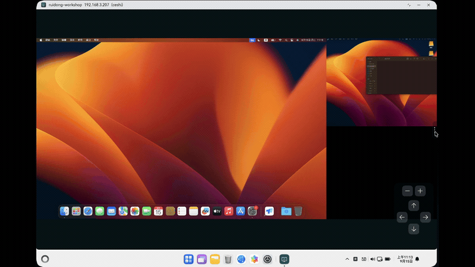
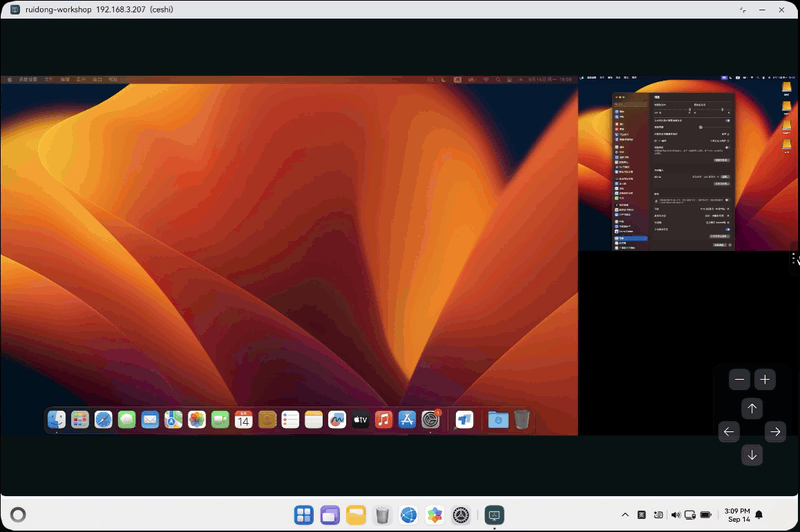

# 翠虎远程桌面

翠虎远程桌面是一款跨平台 VNC 远程桌面客户端，支持 HarmonyOS 和 Android 平台，提供稳定、安全的远程桌面连接体验。

## 预览

以下预览为鸿蒙端实际效果，安卓端同样支持。

### 多显示器场景



### 多窗口并列显示



## 下载安装

应用已上架主流应用市场，可在手机端直接搜索「翠虎远程桌面」安装：

- **HarmonyOS**：华为应用市场（AppGallery），[查看应用详情](https://appgallery.huawei.com/app/detail?id=com.hengqutiandi.vncviewer)
- **Android**：小米应用商店，[查看应用详情](https://app.mi.com/details?id=com.hengqutiandi.vncviewer)

> 华为应用市场网页版仅提供详情预览，实际安装请在 HarmonyOS 5 及以上设备的应用市场内搜索。

也可以从源码自行构建安装，参见[构建](#构建)。

## 功能特性

- **VNC 远程桌面**：通过标准 VNC 协议连接并控制远程计算机，支持画面查看、鼠标、触控与键盘输入。
- **SSH 隧道**：支持可选的 SSH 加密隧道，提供密码认证和公钥认证两种方式，支持 `known_hosts` 主机指纹严格校验，保障连接安全。
- **剪贴板同步**：支持本地与远程之间的文本剪贴板双向同步。
- **多显示器支持**：自动识别多显示器布局，支持屏幕切换、查看模式切换与分屏显示。
- **Mac 模式**：连接 Mac 时自动将 Ctrl 映射为 ⌘ 键，修复剪贴板快捷键等操作习惯差异。
- **连接管理**：支持创建、保存、编辑、删除和搜索远程连接配置，密码可选择本地加密保存。
- **截图保存**：会话过程中支持截图并保存到本地。
- **多窗口模式**（鸿蒙端）：支持将不同显示器内容拆分到独立窗口中查看。
- **画中画模式**（安卓端）：支持画中画悬浮窗，方便多任务场景。

## 平台支持

| 平台 | UI 框架 | 原生桥接 | 构建工具 |
|------|---------|----------|----------|
| HarmonyOS | ArkTS / ArkUI | NAPI | hvigor |
| Android | Jetpack Compose | JNI | Gradle |

## 项目结构

```
greentiger-open/
├── shared_native/           # 双平台共享 C++ 原生层（VNC 客户端、SSH 隧道、多屏检测）
├── ohos_app/                # 鸿蒙端应用（Stage 模型）
│   └── entry/src/main/
│       ├── cpp/             # NAPI 原生桥接
│       ├── ets/
│       │   ├── pages/       # 页面：连接管理、远程会话、分屏显示
│       │   └── utils/       # 工具：按键映射、连接工具、多窗口管理
│       └── module.json5
├── android_app/             # 安卓端应用
│   └── app/src/main/
│       ├── cpp/             # JNI 原生桥接
│       └── AndroidManifest.xml
├── build_tools/gnutls/      # GnuTLS 双平台构建脚本
├── scripts/                 # 构建与辅助脚本
├── third_party/
│   ├── tigervnc/            # TigerVNC 源码（VNC 协议实现）
│   ├── libssh2/             # libssh2 源码（SSH 隧道）
│   └── mbedtls-3.6.6/       # Mbed TLS 源码（加密库）
└── docs/                    # 设计文档与协议
```

## 构建

### 前置条件

- 鸿蒙端：DevEco Studio / hvigor 构建环境、HarmonyOS SDK（脚本会自动定位 DevEco 自带 SDK，也可用 `OHOS_SDK_NATIVE` 指定）
- 安卓端：Android SDK（含 NDK）、JDK 17–21（Kotlin 1.9.24 无法在更高版本 JDK 上运行，脚本会自动选中可用版本）
- 首次构建需要联网：脚本会自动下载并交叉编译 Nettle 与 GnuTLS，产物存放在 `prebuilts/gnutls/`（已被 git 忽略，无需提交、可随时重建）
- 确保已初始化 Git 子模块

构建会先做工具链自检，打印 HarmonyOS SDK / Android NDK / Gradle JDK 的实际位置；缺失项会给出安装或配置提示，无需修改脚本。已知限制：GnuTLS 3.8.4 无法用 NDK 29+ 编译（新版 bionic 头已定义 `timezone_t`），脚本会优先选用可编译的旧版 NDK，机器上只有新版时会提示安装 26.1.10909125。

### 初始化

```bash
git submodule update --init --recursive
```

### 一键构建

```bash
./scripts/build_all.sh          # Debug 模式
./scripts/build_all.sh release  # Release 模式
```

首次构建会自动下载 Nettle 3.9 与 GnuTLS 3.8.4 源码（SHA-256 校验）并交叉编译为 `prebuilts/gnutls/` 下的静态库，需要几分钟；之后的构建会直接复用。指定其它 ABI 可用 `OHOS_ARCH`（鸿蒙：`arm64-v8a`/`x86_64`）与 `ANDROID_ABIS`（安卓：默认 `arm64-v8a x86_64`）。

### 分端构建

**鸿蒙端：**

```bash
cd ohos_app
hvigorw assembleApp                          # Debug 模式
hvigorw assembleApp -p buildMode=release     # Release 模式
```

修改了原生 C++ 代码或 CMakeLists.txt 时需要先 clean：

```bash
hvigorw clean
hvigorw assembleApp
```

**安卓端：**

```bash
cd android_app
./gradlew assembleDebug      # Debug 模式
./gradlew assembleRelease    # Release 模式
```

### 构建产出

- 鸿蒙端：`.hap` / `.app` 包，位于 `ohos_app/build/outputs/`
- 安卓端：`.apk` 包，位于 `android_app/app/build/outputs/apk/`

### 原生测试

`shared_native` 中与平台无关的逻辑有一套宿主机测试，只需要 C++17 编译器，不需要 HarmonyOS SDK、NDK 或真机：

```bash
./scripts/test_native.sh           # 配置、编译并运行
./scripts/test_native.sh --clean   # 从干净目录重新构建
```

测试位于 `shared_native/tests/`，当前覆盖：

- `pixel_convert`：帧缓冲像素格式转换。以改造前的逐像素实现为基准，对全部 byte order、通道交换、非对齐矩形和多宽度做逐字节比对；同时校验 alpha 恒为不透明、源缓冲区只读。
- `monitor_segmentation`：多显示器分割。校验退化输入、矩形始终落在画面内、超宽画面切分与单窗口裁剪。
- `ssh_tunnel_config`：SSH 隧道参数校验与默认值填充。
- `apple_rfb_banner`：从 RFB 版本横幅识别 macOS 屏幕共享。校验完整横幅、截断横幅与读取中途的字节分类（不匹配可立即放弃，前缀匹配则继续等待）。

新增可测试的原生逻辑时，把不依赖平台头文件和第三方库的实现放在 `shared_native/` 的独立源文件中，并在 `shared_native/tests/CMakeLists.txt` 里登记。

## 架构说明

应用采用"共享原生 + 平台 UI"的分层架构：

1. **shared_native**：平台中立的 C++ 层，封装 VNC 连接、SSH 隧道、多显示器分割等核心逻辑。
2. **平台桥接层**：通过 NAPI（鸿蒙）/ JNI（安卓）将 C++ 能力暴露给上层 UI。
3. **平台 UI 层**：鸿蒙端使用 ArkTS/ArkUI，安卓端使用 Jetpack Compose，各自实现用户体验。

`shared_native` 的代码改动必须同时验证双平台构建通过。

## 第三方许可

本项目使用以下开源组件：

- [TigerVNC](https://github.com/TigerVNC/tigervnc) — GPL-2.0
- [libssh2](https://github.com/libssh2/libssh2) — BSD-3-Clause
- [Mbed TLS](https://github.com/Mbed-TLS/mbedtls) — Apache-2.0 / GPL-2.0

本项目本身采用 GPL-2.0 许可证，详见 [LICENCE.TXT](LICENCE.TXT)。

## 相关文档

- [用户协议](https://www.hengqu.world/agreements/user-agreement)
- [隐私政策](https://www.hengqu.world/agreements/privacy-policy)
- [SSH 隧道集成报告](docs/ssh-tunnel-integration-report.md)
- [连接管理 UX 设计规格](docs/connection-management-ux-guidelines.md)

## 法律声明

本仓库历史上曾包含用户协议和隐私政策的副本。这些副本已被移除。
翠虎远程桌面的用户协议与隐私政策以官方网站发布的版本为唯一正式版本：
- [用户协议](https://www.hengqu.world/agreements/user-agreement)
- [隐私政策](https://www.hengqu.world/agreements/privacy-policy)

本仓库中的任何历史副本均不构成横渠天地（北京）科技有限公司对用户的承诺或协议。
构建时，应用通过 `scripts/sync_agreements.py` 从官方网站自动下载协议全文并打包进应用。
